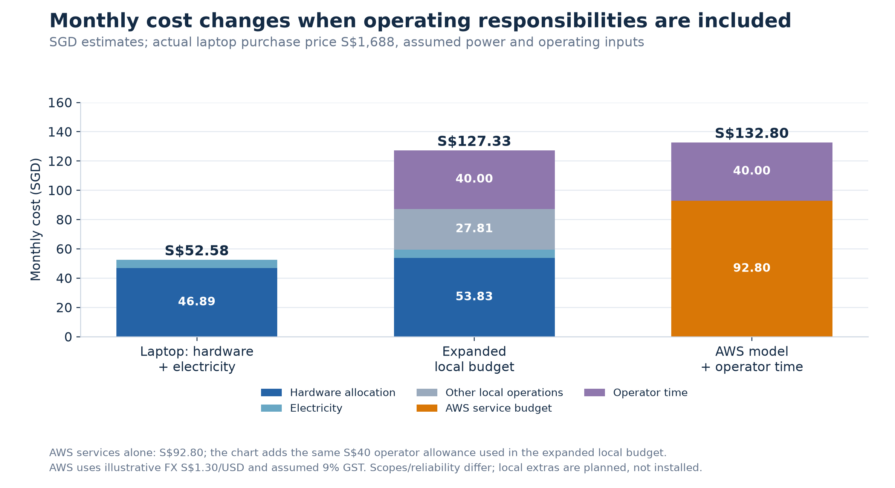
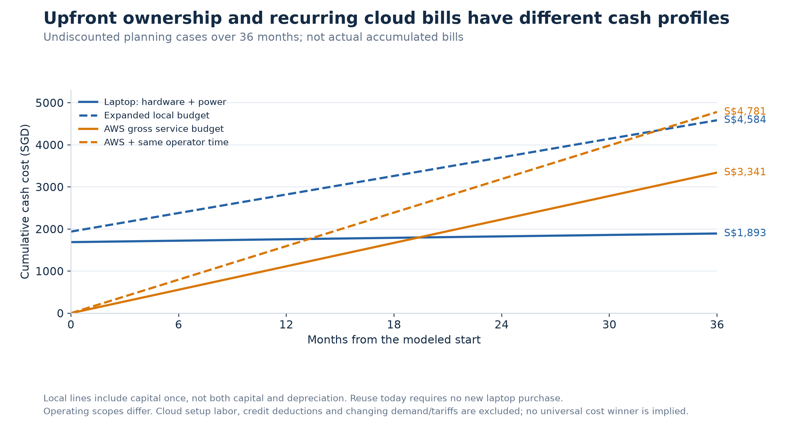
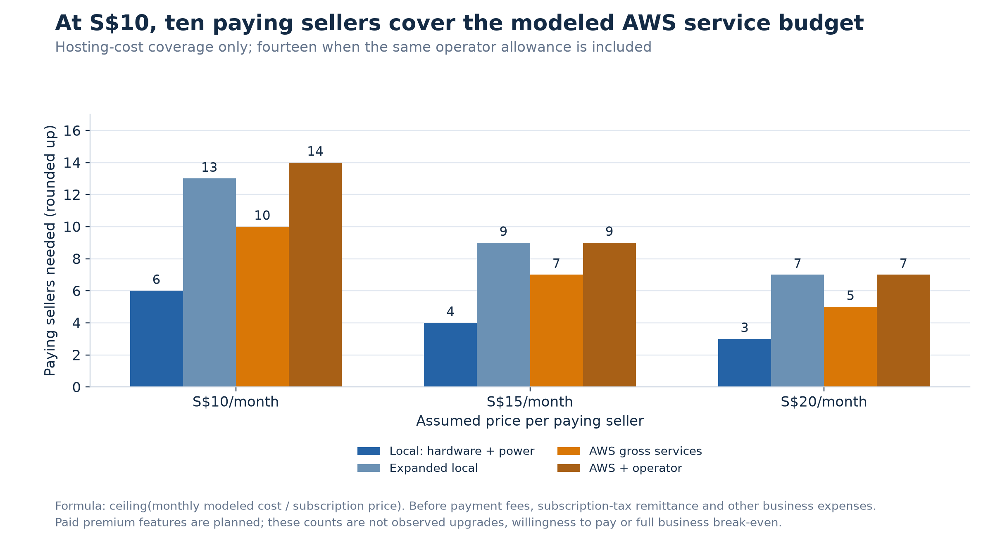
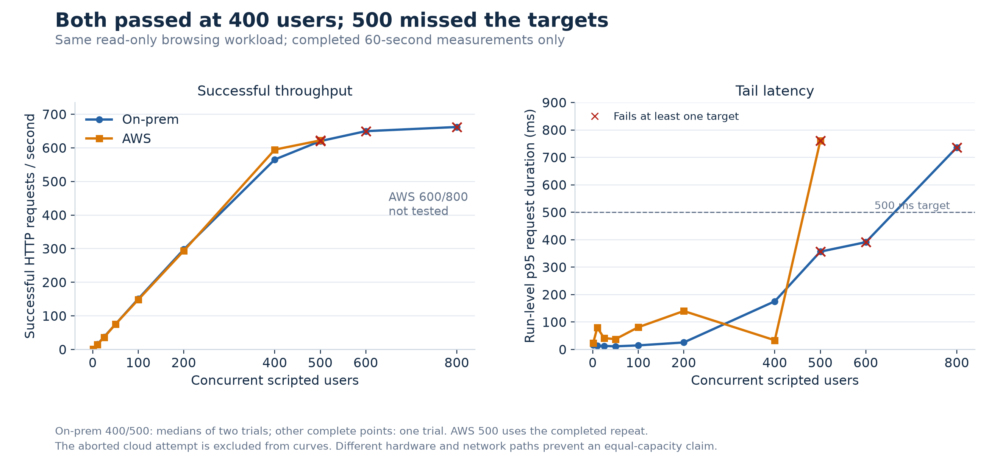
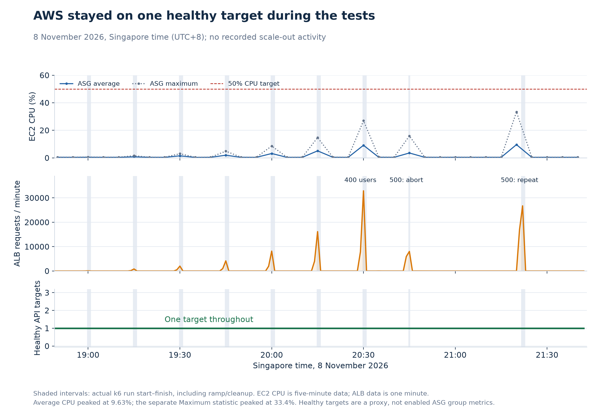
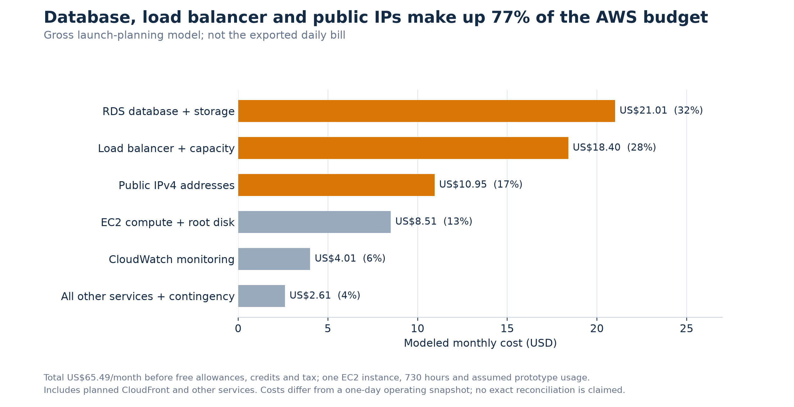

# Carlo's sections for the Group 17 final report

Drafted 9 November 2026 to match the supplied report headings. Sections below contain actual system results and labeled financial assumptions. Survey analysis is pending actual responses. Reference labels E1–E5 are temporary keys to merge into the team's reference list; table/figure numbers must follow the final document order. This file is working material, not the full ten-page Final.pdf.

Selected figures: original graphs 1, 3, 4, 5, 6 and 9 are placed below with short descriptions. Numbers refer to the working figure pack, not final report numbering. Renumber all figures after merging with the architecture diagrams. To protect the ten-page limit, avoid repeating full tables where the selected graphs already convey the same information; graphs 4 and 5 can share a combined figure layout if labels remain readable.

## 3.4 Cloud vs On-Prem & Break-Even

We compared the same application's local Docker deployment with its AWS deployment. Following the course's total cost of ownership framework, we separated capital purchases from recurring operating expenses [E1]. For on-premises hosting, we used the laptop's actual reported purchase price of S$1,688, a 36-month allocation period and zero residual value. Average wall power was assumed at 25 W rather than measured. At 730 operating hours per month, this gives 18.25 kWh. Using the October–December 2026 regulated tariff of S$0.3116/kWh including GST, electricity costs approximately S$5.69 per month [E2].

| Budget scope | Capital basis (S$) | Monthly cost (S$) | 36-month cash cost (S$) |
|---|---:|---:|---:|
| On-prem laptop: hardware and electricity | 1,688 | 52.58 | 1,892.72 |
| Expanded local operations budget | 1,938 | 127.33 | 4,584.00 |
| AWS gross architecture budget | No owned server purchase | 92.80 | 3,340.72 |

The expanded local budget adds assumed UPS and backup hardware, maintenance, additional hosting connectivity, backups and two hours of operator time per month. These additions were not part of the measured deployment. Reusing the existing laptop requires no new laptop purchase, but excluding its ownership cost would understate fully allocated hosting cost. Hardware depreciation is not added again to the cash-cost calculation.

For AWS launch planning, the gross architecture estimate is US$65.49/month before allowances, credits and taxes [E3]. At the report's illustrative exchange rate of S$1.30/US$1 and an assumed 9% GST, this becomes S$92.80. This budget includes planned CloudFront delivery and supporting services; it is not the measured bill for the tested ALB deployment. It excludes setup and operator labor. Adding the same S$40 monthly operator allowance gives S$132.80/month. The local and AWS scopes and reliability differ, so these figures do not establish equal-service cost savings. AWS reduces owned-hardware commitments and provides managed services; the laptop is a single-host prototype.

**Monthly hosting cost composition.** The laptop's hardware and electricity total S$52.58/month. Adding planned operating allowances increases the local budget to S$127.33, compared with S$132.80 for the AWS model with the same operator-time allowance. The chart shows why electricity alone understates ownership cost; the scopes and reliability remain different [E3].

**Cumulative cash cost over 36 months.** Local hosting starts with a hardware purchase, while the modeled cloud cost accumulates through recurring charges. The endpoints depend on which operating responsibilities are included. Capital is counted once, and depreciation is not added again to cash expenditure. These are projections rather than observed three-year bills [E3].

At 28 listings, the minimal local and gross AWS budgets allocate S$1.88 and S$3.31 per listing per month. Cost per monthly active user is monthly cost divided by that month's active users. For an assumed 100 active users, the figures would be S$0.53 and S$0.93; these are planning ratios, not observed production costs or costs per concurrent k6 user.

Hosting-cost coverage is calculated as **ceiling(monthly cost / subscription price)**:

| Scope | At S$10/month | At S$15/month | At S$20/month |
|---|---:|---:|---:|
| Minimal local hardware and electricity | 6 sellers | 4 sellers | 3 sellers |
| Expanded local budget | 13 sellers | 9 sellers | 7 sellers |
| AWS gross architecture budget | 10 sellers | 7 sellers | 5 sellers |
| AWS including the same operator allowance | 14 sellers | 9 sellers | 7 sellers |

At the proposed S$10 launch price, ten paying sellers would cover the gross AWS hosting budget, before payment fees, any subscription-tax remittance and other business expenses. Fourteen would cover hosting plus the stated operator allowance. This is a minimum cost-coverage calculation, not proof of business profitability or willingness to pay. Premium analytics and booking are planned features, so this revenue depends on future implementation and actual upgrades; the existing free prototype has no demonstrated subscription revenue.

**Paying sellers needed to cover modeled monthly costs.** At S$10/month, ten paying sellers cover the gross AWS service budget, or fourteen including operator time. Higher prices reduce the required count, but this calculation excludes fees and other business expenses. It does not demonstrate willingness to pay or actual premium subscriptions [E3].

## 5.1 Performance

We used k6 to compare read-only browsing at matching concurrency levels. Each scripted session searched, requested category/location facets and opened a listing, followed by a 1–3 second pause. Each run used a 15-second ramp and a 60-second measurement. The targets were p95 HTTP request duration below 500 ms, HTTP errors below 1% and checked assertions above 99%. Both environments reported 28 listings. The same k6 image and two-CPU/1-GiB generator limits were used, although full deployed-code and dataset equivalence were not established [E4].

The local stack and generator shared an LG laptop with an Intel Core Ultra 7 256V and 16 GiB RAM; Docker shared eight CPUs and about 7.54 GiB. AWS monitoring identified one healthy t4g.micro application target and a Single-AZ db.t4g.micro PostgreSQL database. Tests accessed AWS through the public ALB, not the full CloudFront frontend path [E5].

| Users | Local p95 (ms) | AWS p95 (ms) | Local successful req/s | AWS successful req/s |
|---:|---:|---:|---:|---:|
| 100 | 14.93 | 81.11 | 150.60 | 148.20 |
| 200 | 25.67 | 140.24 | 297.75 | 293.50 |
| 400 | 175.65 | 33.72 | 565.43 | 594.80 |
| 500 | 356.58 | 760.47 | 620.17 | 622.27 |

Both deployments passed through 400 users. Local 400/500 figures are medians across two trials; the AWS 400 result is one trial. At 500, the local runs failed because HTTP errors reached 4.61% and 2.60%. The completed AWS repeat recorded no HTTP errors but exceeded the latency target. An earlier AWS 500-user attempt was aborted and excluded from full-window throughput comparisons. AWS 600/800 tests were not started after failure. From 400 to 500 users, successful throughput increased only 9.7% locally and 4.6% on AWS despite 25% more scripted users. These results indicate diminishing returns for the tested workload, not an exact production capacity limit.

**Throughput and latency under matching browsing loads.** Both deployments passed at 400 users, but adding users produced smaller throughput gains and failed quality targets at 500. Red crosses indicate failure of any target: local requests could remain fast while HTTP errors increased. The aborted AWS attempt is excluded from the curves; cloud 600/800 were not tested [E4].

Three Lighthouse initial-load tests through Chrome DevTools used mobile emulation and Slow 4G. Scores were 95, 94 and 94, giving a median of 94 against a target of at least 90. Median First Contentful Paint was 1.9 s, Largest Contentful Paint 2.0 s, Total Blocking Time 0 ms and Cumulative Layout Shift 0.115. These measure browser lab performance, separately from API concurrency. The pasted Lighthouse outputs did not identify the tested URL, so no local/cloud browser comparison is claimed.

## 5.2 Scalability & Reliability

The exported AWS monitoring window showed one healthy application target throughout and no recorded scaling activities. The highest five-minute Average CPU datapoint was 9.63%, below the ASG's 50% target. CPU-credit balances remained high. Therefore, neither CPU-credit depletion nor a payment-plan-imposed user cap is supported as an explanation for the 500-user latency failure [E5]. The short load plateaus and coarse CPU measurements also limit this experiment as an autoscaling demonstration.

**AWS workload, CPU and healthy targets during testing.** Request bursts correspond to the test windows, while the healthy API target count stays at one. Average CPU remained below the scaling target at the exported five-minute resolution, and no scale-out was recorded. This shows the observed response of the configured system, rather than a successful elasticity demonstration [E5].

AWS's completed 500-user run had client-facing p95 of 760.47 ms, while its exported one-minute ALB target-response p95 peaked at 288.3 ms. These metrics cover different timing boundaries and aggregations and cannot be directly subtracted. Pool queueing, transient application behavior and external-path effects remain possible, but the exact cause was not established. We report an observed client-facing latency failure, not proven exhaustion of AWS server capacity.

The local 400-user level passed twice, while the cloud level passed once. Short read-only runs and sampled health checks do not establish 99.9% uptime, sustained capacity, write/notification throughput or automatic recovery. Different hardware, network paths, recovery intervals and the local generator sharing application resources further limit direct comparisons. Longer controlled plateaus and an independent generator would strengthen future evaluation; successful scale-out is not claimed.

## 5.4 AWS Infrastructure Cost Breakdown

The gross launch-planning model has the following monthly components in US dollars [E3]. It uses 730 hours, one application instance, one database, assumed prototype traffic and no free allowances or promotional credits.

| Component | US$/month |
|---|---:|
| EC2 and root disk | 8.51 |
| RDS instance and storage | 21.01 |
| ALB and traffic capacity | 18.40 |
| Public IPv4 addresses | 10.95 |
| S3, planned CloudFront, SQS, SES and ECR | 1.59 |
| CloudWatch | 4.01 |
| Cross-AZ transfer and small-usage contingency | 1.02 |
| Total from unrounded components | **65.49** |

**Main drivers of the AWS monthly budget.** RDS, the load balancer and public IPv4 addresses account for approximately 77% of the gross monthly model. At prototype scale, these baseline infrastructure costs dominate the budget. The chart includes planned services and excludes free allowances, credits and tax; it is not the exported daily bill [E3].

The supplied Cost Explorer daily export records US$1.69 on 8 November. If that day repeated, it would imply US$51.40 per 730 hours, but one day is not a verified monthly invoice and its tax/credit treatment is not fully reconciled [E5]. Earlier account totals include unrelated lab resources and should not be assigned entirely to this project. Promotional credits can reduce cash payable without eliminating underlying hosting cost. We therefore keep the observed-day run-rate separate from the conservative architecture budget used in Section 3.4.

## 5.5 User Evaluation — complete after survey analysis

**Drafting placeholder, not findings:** seller needs and customer task/SUS questionnaires have been distributed, with responses expected by 10 November. Add actual sample sizes, recruitment method, task-completion outcomes, SUS scores, seller priorities and stated willingness to pay. If timing and completion are participant-reported, label them accordingly. Separate seller needs research from hands-on customer evaluation; do not claim owner-dashboard usability was tested if sellers only answered questions. Report incomplete responses and the small convenience sample as limitations.

## Reference keys to merge with the shared reference list

* **E1:** CS5224 Lecture 10, *Pricing Models and Modeling TCO*, PDF pp. 14–16 and 23–24; Lecture 04, *Resource Hosting and Datacenter*, PDF pp. 25–28. Local course material. The 36-month horizon and 730-hour month are project assumptions.
* **E2:** Energy Market Authority, [Buying at Regulated Tariff](https://www.ema.gov.sg/consumer-information/electricity/buying-electricity/buying-at-regulated-tariff), October–December 2026 tariff, checked 9 November 2026. Laptop capital is Carlo's reported S$1,688 actual purchase price; power/operating inputs are assumptions.
* **E3:** Group 17, [AWS estimate](cost/aws_estimate.md) and [on-prem cost method](cost/onprem_estimate.md), with official price-list URLs and formulas. Figures are planning estimates; the associated workbooks preserve assumptions.
* **E4:** Group 17, [combined performance report](performance/results/cloud-vs-onprem-20261108/comparison_report.md), original k6 records dated 7–8 November 2026 and [Lighthouse summary](performance/lighthouse_report.md).
* **E5:** Group 17, [AWS monitoring exports at archived commit](https://github.com/cs5224-t17/Cloud-Computing-SaaS/tree/64a03d7741e9779c799a36014c544ff21fb89651/loadtest/aws-2026-11-08), and [independently checked findings](performance/results/cloud-vs-onprem-20261108/aws_monitoring_findings.md). These are team-generated experimental/billing records, not external research citations.
